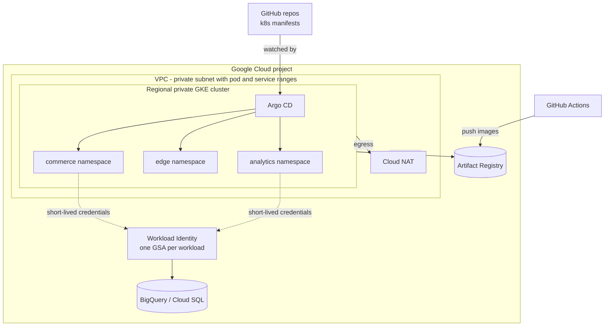

# cloud-platform-terraform

[](https://github.com/sameerkhanp119-dot/cloud-platform-terraform/actions/workflows/ci.yml)


Reference Terraform modules for a Kubernetes platform on Google Cloud, with separate
**dev** and **prod** environments and GitOps delivery through Argo CD. It describes a target platform for the other portfolio projects:
 [commerce-order-platform](https://github.com/sameerkhanp119-dot/commerce-order-platform),
[api-gateway-auth](https://github.com/sameerkhanp119-dot/api-gateway-auth) and
[realtime-event-analytics](https://github.com/sameerkhanp119-dot/realtime-event-analytics).

## Scope and deployment evidence

This is an independent portfolio reference implementation. The `dev` and `prod` names identify configuration profiles; they do not establish that either environment has been deployed or operated in production.

Formatting, validation, linting and static security checks assess configuration quality. They do not prove a successful cloud deployment, application compatibility, recovery behavior, availability or cost. Before using this configuration for a real workload, review the plan, IAM access and network boundaries, verify image provenance, and test application deployment and recovery in your own environment. No production availability or load benchmark is claimed here.

## Architecture



## Modules

| Module | What it creates | Key decisions |
|---|---|---|
| [`network`](modules/network) | VPC, subnet with secondary ranges, Cloud Router + NAT, IAP-only SSH | No public node IPs; flow logs on; egress through NAT |
| [`gke`](modules/gke) | Regional private GKE cluster, autoscaled node pools, node service account | Dataplane V2 (network policy built in), Workload Identity, shielded nodes, managed Prometheus, release channels, maintenance window, surge upgrades with zero unavailability |
| [`artifact-registry`](modules/artifact-registry) | Docker repository with cleanup policies | Immutable tags in prod; keep recent versions; delete untagged layers after 7 days; push limited to the CI identity |
| [`workload-identity`](modules/workload-identity) | One Google service account per workload, bound to its Kubernetes service account | No service-account JSON keys; each workload gets only the roles it needs |

## Environments

| | dev | prod |
|---|---|---|
| Release channel | RAPID (find upgrade issues early) | STABLE |
| Nodes | `e2-standard-4` spot, 1–4 | `n2-standard-4` on-demand 3–12, plus a `n2-highmem-4` spot pool 0–10 for batch |
| Image tags | mutable | immutable |
| Deletion protection | off | on |
| Flow log sampling | 10% | 50% |

Each environment has its own remote state (GCS backend, partial config) so a change to dev can never touch prod state.

## Usage

```bash
cd environments/dev
cp terraform.tfvars.example terraform.tfvars   # set project_id, ci_service_account, admin_cidrs
terraform init -backend-config="bucket=<state-bucket>" -backend-config="prefix=platform/dev"
terraform plan
terraform apply

$(terraform output -raw get_credentials)       # configure kubectl
```

### Bootstrap GitOps

```bash
kubectl create namespace argocd
kubectl apply -n argocd -f https://raw.githubusercontent.com/argoproj/argo-cd/stable/manifests/install.yaml
kubectl apply -f gitops/argocd/
```

Argo CD then keeps each application's `k8s/` folder in sync with the cluster: automated sync, pruning of
removed resources, self-healing of manual drift, and retries with backoff.

### Connect a workload to Google APIs

```bash
kubectl -n analytics annotate serviceaccount streaming-job \
  iam.gke.io/gcp-service-account=$(terraform output -json workload_service_accounts | jq -r '."rta-streaming-dev"')
```

## Quality gates (CI)

Every push and pull request runs:

- `terraform fmt -check` across the repo
- `terraform validate` for each environment (matrix)
- `tflint` with the recommended ruleset (typed variables, no unused declarations, pinned versions)
- `checkov` security scan; any intentionally skipped check is listed with its reason in `.checkov.yaml`

## Roadmap

- Binary Authorization attestation policy so only images signed by CI can run (enforcement is already on)
- Cloud SQL (PostgreSQL) module with private IP for order and payment services
- Policy Controller constraints (no privileged pods, required labels)
- Plan-on-PR workflow authenticated with Workload Identity Federation

## License

MIT
